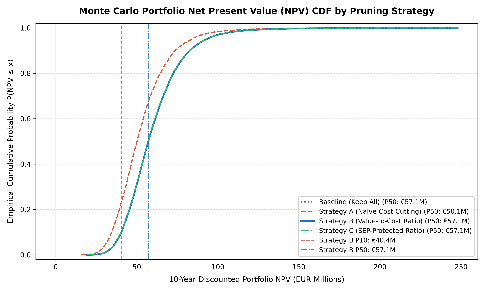
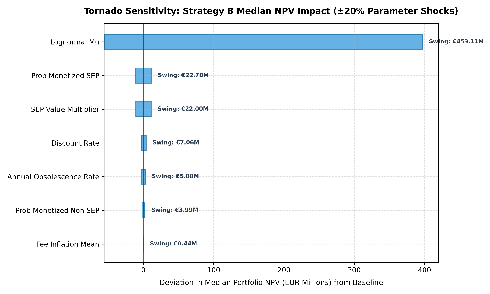

# Executive Decision Memo: Telecom Patent Portfolio Pruning & ROI Analysis

**To**: Chief Intellectual Property Officer (CIPO) & Chief Financial Officer (CFO)  
**From**: IP Strategy & Quantitative Analytics Group  
**Subject**: Monte Carlo 10-Year Portfolio Pruning Strategy & ROI Optimization  
**Date**: November 2026  

---

## 1. Executive Summary & Strategic Recommendation

Under corporate directive to reduce IP maintenance budget expenditures by **20%**, we evaluated 500 telecom patent families using a **10,000-path Monte Carlo Common Random Numbers (CRN)** valuation framework.

- **Recommended Decision: Adopt Strategy B (Value-to-Cost Bang-for-Buck Ratio)**.
- **Cost Reduction Target Met**: Strategy B reduces 10-year discounted renewal spend by **20.2%** (saving **€2,027,769** in expected present-value fees) by abandoning **70 non-performing patent families**.
- **Economic Superiority over Naive Cost-Cutting**: Naive cost-cutting (Strategy A) indiscriminately drops the most expensive patents—inadvertently pruning high-value foreign filings and critical commercial assets. Compared to Strategy A, **Strategy B delivers €7,220,353 (+13.7%) in higher mean portfolio NPV** and **€6,957,284 higher median NPV**.
- **Downside Risk Protection**: Strategy B maintains a resilient P10 downside threshold of **€40,382,778** (vs. €34,493,701 for Strategy A) and holds the probability of net lifetime loss to **0.00%**.

---

## 2. Pruning Strategy Comparison

| Strategy | Patents Kept | Patents Abandoned | Expected PV Cost (EUR) | Cost Cut % | P10 NPV (EUR) | P50 NPV (EUR) | P90 NPV (EUR) | Prob(Loss) |
| :--- | :---: | :---: | :---: | :---: | :---: | :---: | :---: | :---: |
| **Baseline (Keep All)** | 500 | 0 | €10,034,132 | 0.0% | €40,321,055 | €57,139,556 | €82,729,136 | 0.00% |
| **Strategy A (Naive Cost-Cutting)** | 434 | 66 | €8,010,478 | 20.2% | €34,493,701 | €50,131,110 | €73,582,523 | 0.00% |
| **Strategy B (Value-to-Cost Ratio)** | 430 | 70 | €8,006,363 | 20.2% | €40,382,778 | €57,088,394 | €82,721,639 | 0.00% |
| **Strategy C (SEP-Protected Ratio)** | 430 | 70 | €8,006,363 | 20.2% | €40,382,778 | €57,088,394 | €82,721,639 | 0.00% |

### Portfolio NPV Distribution Overview

---

## 3. Sensitivity & Tornado Analysis

A One-At-a-Time (OAT) parameter shock (±20%) and Latin-Hypercube Sampling (LHS) across 1,000 multi-parameter trajectories show that the portfolio decision is overwhelmingly governed by **two key drivers**:

1. **`lognormal_mu`**: Drives the primary magnitude of portfolio monetization (Tornado Swing: **€453,107,684**; Spearman Rank Correlation: **0.992**).
2. **`prob_monetized_sep`**: Dictates standard-essential patent leverage and monetization probability (Tornado Swing: **€22,699,369**; Spearman Rank Correlation: **0.083**).

| Rank | Parameter | Baseline | Low (-20%) | High (+20%) | Median NPV Swing (EUR) | Spearman Rank Corr |
| :---: | :--- | :---: | :---: | :---: | :---: | :---: |
| 1 | `lognormal_mu` | 9.800 | 7.840 | 11.760 | €453,107,684 | +0.992 |
| 2 | `prob_monetized_sep` | 0.450 | 0.360 | 0.540 | €22,699,369 | +0.083 |
| 3 | `sep_value_multiplier` | 3.200 | 2.560 | 3.840 | €21,996,039 | +0.093 |
| 4 | `discount_rate` | 0.080 | 0.064 | 0.096 | €7,057,072 | -0.038 |
| 5 | `annual_obsolescence_rate` | 0.050 | 0.040 | 0.060 | €5,800,504 | -0.021 |
| 6 | `prob_monetized_non_sep` | 0.120 | 0.096 | 0.144 | €3,994,443 | +0.005 |
| 7 | `fee_inflation_mean` | 0.030 | 0.024 | 0.036 | €442,464 | +0.008 |

### Tornado Sensitivity Chart

---

## 4. Top 10 Abandoned Patent Families under Strategy B

The following patent families exhibit the lowest expected return per euro of maintenance cost and are scheduled for immediate non-renewal under Strategy B:

| Family ID | Jurisdiction | Tech Domain | Is SEP? | Expected PV Cost (EUR) | Expected NPV (EUR) | Bang-for-Buck (E[NPV]/Cost) |
| :--- | :---: | :--- | :---: | :---: | :---: | :---: |
| `FAM-0141` | EP | LEGACY_3G_4G | No | €28,878 | €-5,179 | -0.179 |
| `FAM-0381` | EP | CORE_NETWORK | No | €27,297 | €-4,636 | -0.170 |
| `FAM-0088` | EP | VIDEO_CODEC | No | €26,886 | €-4,495 | -0.167 |
| `FAM-0228` | EP | LEGACY_3G_4G | No | €27,131 | €-4,256 | -0.157 |
| `FAM-0232` | EP | 5G_RAN | No | €31,573 | €-4,402 | -0.139 |
| `FAM-0093` | EP | CORE_NETWORK | No | €30,621 | €-4,233 | -0.138 |
| `FAM-0315` | EP | IOT_CONNECTIVITY | No | €28,707 | €-3,038 | -0.106 |
| `FAM-0354` | EP | IOT_CONNECTIVITY | No | €29,591 | €-2,965 | -0.100 |
| `FAM-0109` | US | VIDEO_CODEC | No | €25,566 | €-1,940 | -0.076 |
| `FAM-0103` | US | 5G_RAN | No | €27,555 | €-2,088 | -0.076 |

---

## 5. Implementation Roadmap

1. **Execution**: Transmit abandonment instructions for the identified families to foreign patent annuities agents prior to Q1 renewal deadlines.
2. **Continuous Monitoring**: Re-evaluate the portfolio annually under updated citation counts and standardization declarations using this Monte Carlo simulator.
